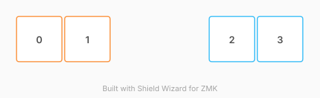

# ZMK Configuration for dsasdasd

*Generated by Shield Wizard for ZMK*



Download compiled firmware from the Actions tab. <https://zmk.dev/docs/user-setup#installing-the-firmware>

Edit your keymap <https://zmk.dev/docs/keymaps>.
User keymap is located at [`config/dsasdtest.keymap`](config/dsasdtest.keymap).

-----

<details>
<summary>
Shield Wizard Debug Information
</summary>

In case of broken configuration, here is the Shield Wizard internal data used to generate this configuration:

Commit: 84a348b08cf4fec4a5441a46147e9a345b10ffab

```json
{"name":"dsasdasd","shield":"dsasdtest","dongle":false,"modules":["petejohanson/cirque"],"layout":[{"id":"01M4WVEG694RWV0YSDDMM4W5F7","part":0,"row":0,"col":-1,"w":1,"h":1,"x":0,"y":0,"r":0,"rx":0,"ry":0},{"id":"01M4WVEGPYKMDSNDEHRA3JVBND","part":0,"row":0,"col":0,"w":1,"h":1,"x":1,"y":0,"r":0,"rx":0,"ry":0},{"id":"01M4XNFK48YRQ8M9ACWNQW18BS","part":1,"row":0,"col":2,"w":1,"h":1,"x":4,"y":0,"r":0,"rx":0,"ry":0},{"id":"01M4XNFKWGNP27XW5SMFMPR3Y1","part":1,"row":0,"col":3,"w":1,"h":1,"x":5,"y":0,"r":0,"rx":0,"ry":0}],"parts":[{"name":"left","controller":"nice_nano_v2","pins":{"d7":{"usage":"bus","bus":"spi0","role":"sck"},"d0":{"usage":"bus","bus":"spi0","role":"miso"},"d6":{"usage":"bus","bus":"spi0","role":"mosi"},"d2":{"usage":"device","deviceId":"01M4WVF17G9CK9D47K93PY866A","role":"cs"},"d3":{"usage":"device","deviceId":"01M4WVF17G9CK9D47K93PY866A","role":"dr"},"d19":{"usage":"kscan","kscan":"01M4XN97ZR3Y6Z0X66P506KB1A","role":"input"},"d18":{"usage":"kscan","kscan":"01M4XN97ZR3Y6Z0X66P506KB1A","role":"input"}},"kscans":[{"kind":"direct","id":"01M4XN97ZR3Y6Z0X66P506KB1A","mode":"gnd"}],"keys":{"01M4WVEG694RWV0YSDDMM4W5F7":{"input":"d19"},"01M4WVEGPYKMDSNDEHRA3JVBND":{"input":"d18"}},"encoders":[],"buses":{"spi0":{"type":"spi","devices":[{"id":"01M4WVF17G9CK9D47K93PY866A","type":"pinnacle_spi","rotate90":false,"invertx":false,"inverty":false,"sleep":true,"noSecondaryTap":true,"noTaps":true,"sensitivity":"2x"}]}}},{"name":"right","controller":"nice_nano_v2","pins":{"d19":{"usage":"kscan","kscan":"01M4XNCQM01ZAXJ2NY03HGFFZ6","role":"input"},"d18":{"usage":"kscan","kscan":"01M4XNCQM01ZAXJ2NY03HGFFZ6","role":"input"},"d7":{"usage":"bus","bus":"spi0","role":"sck"},"d6":{"usage":"bus","bus":"spi0","role":"mosi"},"d0":{"usage":"bus","bus":"spi0","role":"miso"},"d2":{"usage":"device","deviceId":"01M4XNE4Z209V5GW71HVWHK921","role":"cs"},"d3":{"usage":"device","deviceId":"01M4XNE4Z209V5GW71HVWHK921","role":"dr"}},"kscans":[{"kind":"direct","id":"01M4XNCQM01ZAXJ2NY03HGFFZ6","mode":"gnd"}],"keys":{"01M4XNFK48YRQ8M9ACWNQW18BS":{"input":"d18"},"01M4XNFKWGNP27XW5SMFMPR3Y1":{"input":"d19"}},"encoders":[],"buses":{"spi0":{"type":"spi","devices":[{"id":"01M4XNE4Z209V5GW71HVWHK921","type":"pinnacle_spi","rotate90":false,"invertx":false,"inverty":false,"sleep":true,"noSecondaryTap":true,"noTaps":true,"sensitivity":"2x"}]}}}]}
```

</details>
